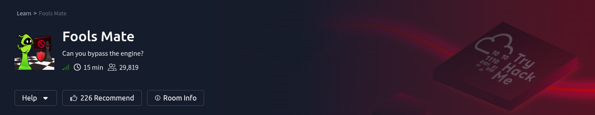
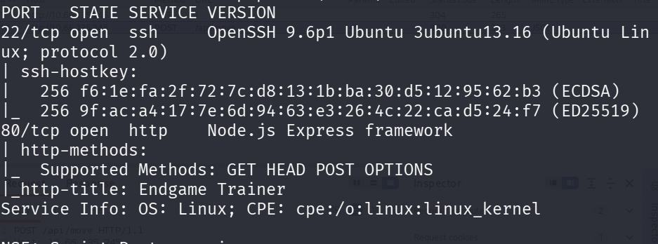
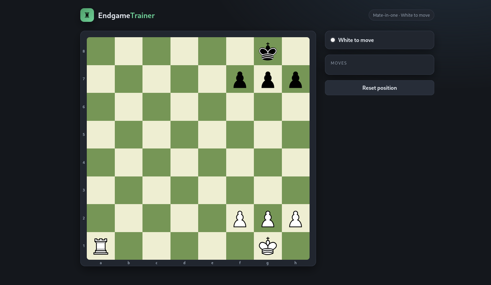
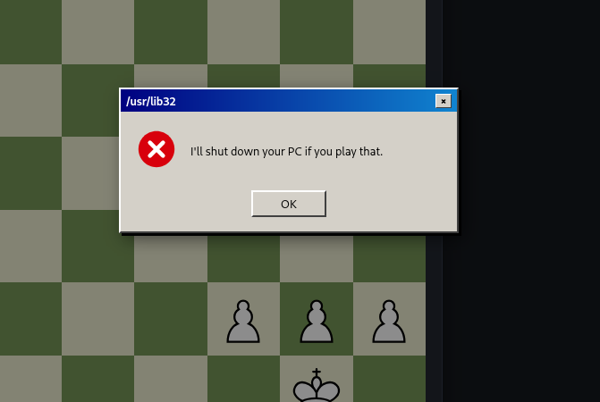
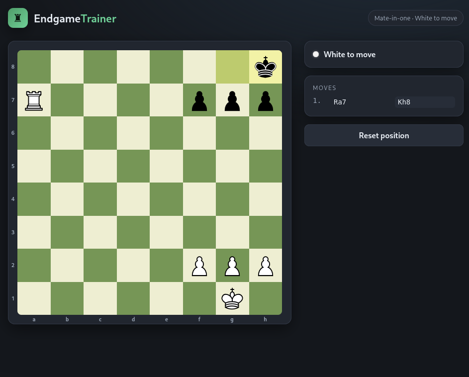
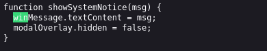
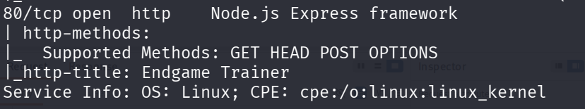
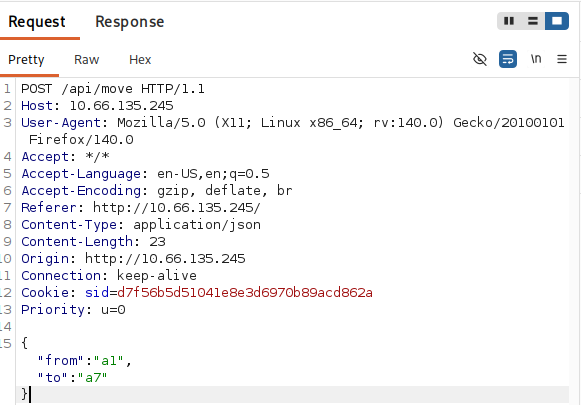
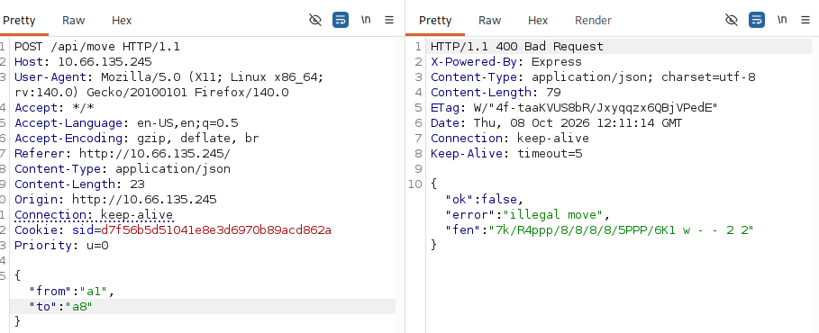
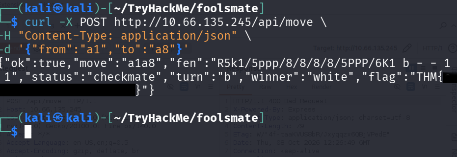

# 🏴 CTF - Fools Mate



> *Can you bypass the engine?*

| | |
|---|---|
| **Plataforma** | TryHackMe |
| **Dificuldade** | Easy |
| **Categoria** | Web |
| **Data** | 08/10/2026 |
| **Sala** | [Fools Mate](https://tryhackme.com/room/foolsmate) |

---

## Objetivo

Dar xeque-mate no adversário e capturar a flag.

---

## Reconhecimento

Comecei com um scan básico do nmap para descobrir as portas abertas e os serviços rodando:

```bash
nmap -sC -sV -p- <IP>
```

- `-sC`: executa os scripts padrão do nmap
- `-sV`: detecta a versão dos serviços
- `-p-`: varre todas as 65535 portas



### Portas encontradas

| Porta | Serviço | Versão                                  |
| ----: | ------- | --------------------------------------- |
|    22 | SSH     | OpenSSH 9.6p1         |
|    80 | HTTP    | Node.js Express Framework      |

---

## Análise da aplicação web (porta 80)

Ao acessar o site, **EndgameTrainer** ("treinador de finais", em tradução livre), me deparei com uma partida de xadrez no fim de jogo. Eu jogava com as peças brancas e estava a **uma jogada do xeque-mate**.



Só havia um pequeno problema: ao mover a torre para `a8` para dar o xeque-mate, aparecia uma ameaça de que o computador seria desligado.



Para entender o comportamento, testei outras jogadas, incluindo mover a torre para uma casa antes de `a8`. Nada de estranho aconteceu:



### Lendo o código-fonte

Abri o código-fonte da página e encontrei o arquivo **`app.js`**, que concentra toda a lógica do tabuleiro, incluindo a função que exibe o aviso.



Isso já indicava que a "proteção" rodava no navegador, ou seja, no lado do cliente, que eu controlo. Eu poderia manipular o JavaScript, mas decidi olhar outra coisa antes.

### Pista no nmap

Voltei ao resultado do nmap, que listava os métodos HTTP aceitos pela aplicação: `GET`, `HEAD`, **`POST`** e `OPTIONS`.



Esses métodos são comuns em muitos servidores e não provam nada sozinhos, mas combinados com o fato de a lógica do jogo estar em JavaScript, levantaram uma hipótese: **e se a jogada fosse enviada ao servidor por uma requisição POST?** Se fosse, eu poderia mandar essa requisição diretamente, sem passar pela interface (e pelo aviso). Eu já tinha visto uma abordagem parecida em um vídeo de CTF de HTB, o que me deu a ideia.

### Montando a requisição

Esta foi a parte mais demorada, e tive que estudar mais sobre o `curl`. O que me ajudou foi observar as requisições e as mensagens de erro no **Burp Suite**:




> 

O comando final foi:

```bash
curl -X POST http://<IP_da_Maquina>/api/move \
  -H "Content-Type: application/json" \
  -d '{"from":"a1","to":"a8"}'
```

- `-X POST`: define o método HTTP (o curl já usaria POST por causa do `-d`, mas deixo explícito por clareza)
- `-H "Content-Type: application/json"`: avisa ao servidor que o corpo da requisição é JSON
- `-d '{...}'`: o corpo da requisição, com a casa de origem (`a1`) e a de destino (`a8`) da torre

---

## 🚩 Flag

Enviada a jogada direto ao servidor, o xeque-mate foi aceito e a flag veio na resposta:



---

## Vulnerabilidade e lições aprendidas

**Vulnerabilidade:** controle de segurança aplicado apenas no lado do cliente ([CWE-602](https://cwe.mitre.org/data/definitions/602.html)). A trava que impedia o xeque-mate existia só no JavaScript do navegador. Como o cliente está sob controle do usuário, basta ignorar a interface e falar direto com a API.

**Como corrigir:** toda regra importante deve ser validada **no servidor**. O front-end serve para conveniência e experiência de uso, nunca como barreira de segurança.

**O que aprendi:**
- Se a interface bloqueia algo, vale testar se o servidor também bloqueia.
- Ler o código JS da página costuma revelar endpoints e a lógica da aplicação.
- Pratiquei `curl` com requisições POST em JSON e a leitura de erros no Burp Suite.
- Preciso estudar mais JavaScript.

Foi de longe o lab mais fácil que fiz na TryHackMe, mas me obrigou a aprender bastante sobre o `curl`.

---

## Ferramentas utilizadas

- `nmap`
- `Burp Suite`
- `cURL`

---

## ⚠️ Disclaimer

Este writeup foi criado para fins educacionais e documenta uma máquina/CTF criada para prática de segurança ofensiva.

Não utilize as técnicas apresentadas contra sistemas sem autorização.